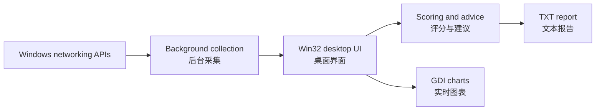

<div align="center">

<h1>WiFi 检测优化助手 · WiFi Diagnostics</h1>

<p>用 Rust 和原生 Win32 构建的 Windows 无线网络诊断工具</p>
<p>A native Windows desktop tool for Wi-Fi inspection and troubleshooting</p>


<p><a href="#zh-cn">简体中文</a> · <a href="#en">English</a> · <a href="#source-map">项目结构 / Source map</a></p>

</div>

---

<a name="zh-cn"></a>

## 简体中文

查看当前 Wi-Fi 的信号与连接参数，比较附近接入点的信道，再用网关和外网探测缩小问题范围。扫描和测试结果可以连同诊断建议导出为一份文本报告。

### 功能一览

| 页面 | 可以做什么 |
| --- | --- |
| **概览** | 查看 SSID、频段、信道、无线协议、协商速率、认证加密、IPv4 网关和 DNS。信号曲线保留最近 120 次采样。 |
| **周边网络与信道** | 按信号强度查看接入点及其 BSSID、RSSI 和安全模式。比较 2.4 GHz 与 5 GHz 信道拥挤度，查看建议候选信道。扫描结果也可列出 6 GHz 接入点。 |
| **延迟测试** | 并行测试 IPv4 网关（可用时）、阿里 DNS、腾讯 DNS 和百度。每个目标发送 8 个 ICMP 探测包，统计平均、最低和最高延迟、抖动与丢包，并单独计时域名解析。 |
| **优化建议** | 根据采集数据生成健康评分和分项建议，并提供路由器管理页、Wi-Fi 设置、位置权限设置和刷新 DNS 缓存的入口。 |

窗口顶部的 **重新检测** 可发起新一轮检测。**导出报告** 将当前连接、扫描结果、延迟统计和诊断建议保存为 UTF-8 TXT 文件。

### 构建与运行

需要 Windows、Rust stable 的 MSVC 工具链，以及安装了 **使用 C++ 的桌面开发** 工作负载的 Visual Studio Build Tools。项目已在 Windows 11 x64 上验证。 [Rust 安装指南](https://rust-lang.org/tools/install/)

在 PowerShell 中运行以下命令。克隆私有仓库时，请使用有访问权限的 GitHub 账号。

```powershell
git clone https://github.com/bTLzJazz/rust-win32-wifi-tool.git
cd rust-win32-wifi-tool
cargo build --release --locked
.\target\release\wifi_tool.exe
```

也可以在资源管理器中双击 `target\release\wifi_tool.exe`。运行 `cargo test --locked` 可验证频段识别、安全模式解析、信道干扰计算和延迟统计。

### 检测结果怎么读

- **信道推荐**根据扫描到的接入点、信号强度和信道重叠估算。实际可选信道以路由器设置为准，效果可通过切换后的实测比较。
- **延迟与丢包**基于 IPv4 ICMP。若目标无应答，可结合其他探测目标和实际访问情况判断。域名解析计时可能包含系统缓存命中。
- **位置权限**可能影响 Windows 对 WLAN 信息的访问。遇到拒绝访问时，在「优化建议」中点击「打开位置权限设置」，检查定位服务和桌面应用权限，然后重新检测。延迟测试可独立运行。 [Microsoft WLAN 位置权限说明](https://learn.microsoft.com/zh-cn/windows/win32/nativewifi/wi-fi-access-location-changes)

---

<a name="en"></a>

## English

Inspect your Wi-Fi signal and connection details, compare channels used by nearby access points, and probe your gateway and internet targets to narrow down connectivity problems. Export the results and recommendations as a single text report. The desktop interface is in Simplified Chinese.

### Features

| Tab | What it shows or does |
| --- | --- |
| **Overview** (概览) | Shows the SSID, band, channel, wireless standard, negotiated link rates, security, IPv4 gateway, and DNS servers. The signal chart retains the latest 120 samples. |
| **Nearby networks & channels** (周边网络与信道) | Lists access points by signal strength with BSSID, RSSI, and security mode. Compares 2.4 GHz and 5 GHz channel congestion and suggests candidate channels. Scan results can also include 6 GHz access points. |
| **Latency test** (延迟测试) | Tests the IPv4 gateway when available, Alibaba DNS, Tencent DNS, and Baidu in parallel. Sends eight ICMP probes per target and reports average, minimum, and maximum latency, jitter, and packet loss. Times DNS resolution separately. |
| **Recommendations** (优化建议) | Shows a health score and findings, with shortcuts to the router admin page, Wi-Fi settings, location settings, and a DNS cache flush. |

Use **Rescan** (重新检测) to request a fresh scan. **Export report** (导出报告) saves connection details, scan results, latency statistics, and recommendations as a UTF-8 TXT file.

### Build and run

You need Windows, the Rust stable MSVC toolchain, and Visual Studio Build Tools with the **Desktop development with C++** workload. The project has been verified on Windows 11 x64. [Rust installation guide](https://rust-lang.org/tools/install/)

Run these commands in PowerShell. For a private repository, sign in with a GitHub account that has access.

```powershell
git clone https://github.com/bTLzJazz/rust-win32-wifi-tool.git
cd rust-win32-wifi-tool
cargo build --release --locked
.\target\release\wifi_tool.exe
```

You can also double-click `target\release\wifi_tool.exe` in File Explorer. Run `cargo test --locked` to check band detection, security mode parsing, interference scoring, and latency statistics.

### Interpreting results

- **Channel suggestions** estimate congestion from the access points seen in a scan, their signal strengths, and channel overlap. Check which channels your router supports and compare performance after changing channels.
- **Latency and packet loss** come from IPv4 ICMP probes. If a target gives no reply, compare it with other probe results and your actual connection. DNS timing can include a system cache hit.
- **Location permissions** can affect Windows access to WLAN information. If access is denied, open **Location settings** (打开位置权限设置) from **Recommendations** (优化建议), check location services and desktop app access, then rescan. The latency test runs independently. [Microsoft WLAN location access documentation](https://learn.microsoft.com/en-us/windows/win32/nativewifi/wi-fi-access-location-changes)

---

<a name="source-map"></a>

## 项目结构 · Source map



| 文件 / File | 职责 / Responsibility |
| --- | --- |
| [`src/main.rs`](src/main.rs) | 程序入口 / Application entry point |
| [`src/ui.rs`](src/ui.rs) | Win32 窗口、选项卡、列表和保存对话框 / Win32 window, tabs, list views, and save dialog |
| [`src/network.rs`](src/network.rs) | Native Wi-Fi 扫描、IP Helper 路由信息和 ICMP 探测 / Native Wi-Fi scans, IP Helper route data, and ICMP probes |
| [`src/charts.rs`](src/charts.rs) | GDI 信号曲线和信道柱状图 / GDI signal and channel charts |
| [`src/diagnostics.rs`](src/diagnostics.rs) | 信道评分、延迟统计、诊断建议与报告生成 / Channel scoring, latency statistics, advice, and report generation |
| [`app.manifest`](app.manifest) | Windows 通用控件与 DPI 声明 / Windows common controls and DPI awareness |
